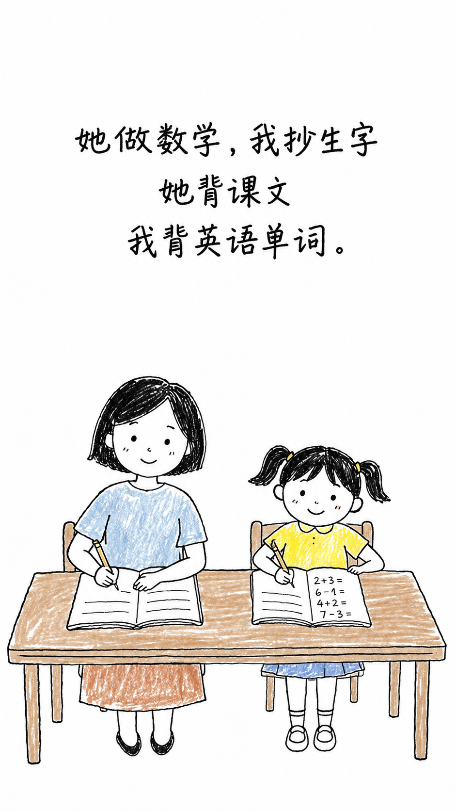

# hand-draw-video-skill ✏️🎬

> 一个让 AI Agent（ZCode / Claude Code / Cursor 等）按可复用工作流，把一段中文故事做成「灰度扫入彩色」手绘风格竖版短视频（9:16）的 Skill。
> 完整覆盖：故事拆分 → 角色全家福参考图 → AI 生图（人物一致）→ Remotion 三层四遮罩动画 → 预览确认 → 渲染 MP4 → 抖音发布文案。

> An **AI-agent Skill** (a single `SKILL.md` + style reference prompts) that turns a Chinese short story into a vertical hand-drawn-style video: **text reveal → grayscale sweep → color sweep**, rendered with [Remotion](https://www.remotion.dev/) at 9:16 / 1080×1920 / 30fps, plus an auto-generated Douyin/TikTok caption. Built for the Chinese short-video audience (warm/healing/family stories). Ships with **6 locked art styles**.

---

## English Summary

`hand-draw-video-skill` is a reusable prompt/skill package (not a runnable app by itself). You drop it into any agent that understands the `SKILL.md` convention (ZCode, Claude Code, Cursor, etc.). Once loaded, you can simply tell the agent something like *"用这个 skill 帮我把下面这段故事做成手绘视频"* and it will drive the full pipeline:

1. **Split** the story into scenes (one image per scene, ≤3 lines / ≤20 chars per line).
2. **Generate a character group portrait** as a visual anchor for cross-scene consistency — *pauses for your confirmation* before going further.
3. **AI-generate each scene** in one of 6 locked styles (A coloring page / B light-color sketch / C Scandinavian gouache / D low-sat coloring page / F soft watercolor picture book / G naive children's storybook), 9:16, with the Chinese text baked into the top 30% and a small white gap before the illustration.
4. **Compose in Remotion** using a 3-stage, 4-layer mask animation (`text reveal → grayscale sweep → color sweep`) on the *same source image* (grayscale is just desaturated, never a re-generation — otherwise faces "jump").
5. **Preview** in Remotion Studio → **render** MP4 → **write a Douyin caption**.

Requirements at runtime: Node.js + Remotion, any AI image generator, FFmpeg (optional, for audio mix). See [Dependencies](#依赖-dependencies).

---

## 适用场景

- 想批量做抖音/小红书「人间温暖」「治愈系」「亲子烟火」类手绘故事号的创作者
- 有故事/脚本，想用 AI Agent 一条龙产出竖版动画视频的人
- 想学习「灰度扫入彩色」这种竖版短视频动画原理的开发者

> ⚠️ 本仓库是 **Skill（提示词工程产物）**，不是一个能直接 `npm start` 的应用。它指导 AI Agent 去动态生成 Remotion 项目代码。运行时由 Agent 现场创建。

## 工作管线总览

```
故事拆分 → 角色全家福参考图 → AI生图(逐场,带参考图) → 场景清单(JSON)
       ↓
Remotion合成(四层遮罩: 文字扫入→灰度→彩色)
       ↓
预览确认 → 渲染MP4 → 生成抖音发布文案
```

## 示例图片

下面是一张由本 skill 生成的 9:16 手绘故事场景图，展示了“顶部文字区 + 中下部插画 + 纯白背景”的版式约束。它可以直接作为 Remotion 的单场输入图片：



> 示例场景文字：“她做数学，我抄生字；她背课文，我背英语单词。”

**两个关键暂停点（skill 强制要求）**：
- 🅰️ 生成角色全家福后**暂停**，展示给用户确认人物形象无误，再继续逐场生图。
- 🅱️ Remotion 代码写完后**暂停**，启动 `npx remotion studio` 预览，用户确认动画效果后再渲染。

## 相关技能与工作流程

这个 skill 不是单一的生图提示词，而是一组由 AI Agent 协调执行的相关能力。每项能力都有明确的输入、输出和质量约束，最终组合成一条可复用的视频生产流水线。

### 相关技能

| 能力 | 主要职责 | 关键约束 / 产物 |
|------|----------|----------------|
| **故事策划与场景拆分** | 将中文故事整理成连续、可视化的核心情节 | 一场一张图；每场 ≤3 行、每行 ≤20 字；输出场景清单 |
| **角色设定与一致性管理** | 提取角色外貌、服装、体型和关系，生成角色全家福参考图 | 全片共用角色参考图；生成场景前必须让用户确认 |
| **环境连续性设计** | 为主要地点准备环境参考，保持同一空间的装修和道具连续 | 同一场景复用环境参考图，避免画面空间跳变 |
| **风格提示词编排** | 从 A/B/C/D/F/G 中选择并锁定一种视觉风格 | 全片只使用一种风格；将角色、主体和文字替换进对应提示词 |
| **AI 图片生成与调度** | 为每个场景生成 9:16 图片，并带入角色参考图 | 顶部文字区、纯白背景、插画与文字留白分离；并行最多 5 张，文件名必须唯一 |
| **图片质量校验** | 检查文字可读性、角色一致性、插画是否侵入文字区域 | 发现插画进入文字区时必须重生，不进入 Remotion 合成 |
| **Remotion 动画合成** | 用同一张原图生成文字、灰度和彩色的分阶段扫入效果 | 四层结构、固定顶部 33% 文字遮罩、每场 198 帧（6.6 秒 @ 30fps） |
| **预览与成片渲染** | 启动 Remotion Studio，确认视觉效果后输出 MP4 | 先预览、后渲染；渲染必须由用户明确触发 |
| **音频处理** | 接入用户提供的 BGM，必要时混合外部人声 | 默认成片需要 BGM；有配音时再降低 BGM 音量并用 FFmpeg 混音 |
| **短视频发布文案** | 根据故事生成标题、短文案和话题标签 | 输出 `douyin-caption.txt`；标题 ≤20 字，文案 2–4 句、≤80 字 |

### 分阶段执行流程

```text
阶段 1：理解故事
  输入：中文故事 / 脚本 / 主题
  输出：角色表、场景列表、每场文字、风格建议
  约束：每场只表达一个核心情节
       ↓
阶段 2：建立视觉锚点
  输入：角色表、服装和外貌描述
  输出：角色全家福参考图、环境参考图
  检查：暂停并等待用户确认角色形象
       ↓
阶段 3：生成场景图片
  输入：场景列表、选定风格、角色参考图、环境参考图
  输出：9:16 场景图片、JSON Manifest
  检查：文字区域、纯白背景、人物一致性、文件名唯一性
       ↓
阶段 4：创建 Remotion 项目
  输入：Manifest、场景图片
  输出：`package.json`、`src/index.tsx`、`src/Scene.tsx`
  实现：白底 → 灰度扫入 → 彩色扫入，文字层单独置顶
       ↓
阶段 5：预览与确认
  输入：Remotion 项目
  输出：Studio 预览链接
  检查：逐场查看文字扫入、灰度和彩色衔接、人物是否变脸
       ↓
阶段 6：渲染与音频
  输入：用户确认的预览、可选 BGM / 人声
  输出：MP4 成片、规格校验结果
  规则：用户明确要求渲染且 BGM 状态已确认后才能出片
       ↓
阶段 7：发布准备
  输入：故事内容、成片主题
  输出：`douyin-caption.txt`（标题、文案、标签）
```

### Agent 的执行原则

- **先确认再扩展**：角色全家福未确认前，不生成逐场图片。
- **先预览再渲染**：代码完成后默认只启动 Studio，不自动渲染 MP4。
- **同图双层**：灰度层和彩色层引用同一张原图，禁止重新生成“线稿图”。
- **失败可重试**：图片不合格时优先调整提示词并重生，最多重试 3 次；仍不合格再更换风格。
- **用户掌握成片开关**：渲染属于明确的成片动作；缺少 BGM 时必须先询问用户选择添加音乐或输出静音版本。

## 六种内置绘图风格

全片锁定一种。详细提示词见 `references/styles/*.md`。

| 风格 | 文件 | 视觉特征 | 适用故事类型 |
|------|------|----------|-------------|
| **A — 儿童涂色页** | `references/styles/A.md` | 粗黑马克笔线稿 + 蜡笔露白填色，越界手误 | 童趣、亲子、幼儿园向 |
| **B — 淡彩速写** | `references/styles/B.md` | 靛蓝钢笔线 + 大面积留白 + 单点高饱和橙 | 怀旧、温柔、家庭叙事 |
| **C — 北欧水粉** | `references/styles/C.md` | 矢车菊蓝 + 芥末黄克制配色，水粉干笔纹理 | 温馨、治愈、绘本感 |
| **D — 低饱和涂色** | `references/styles/D.md` | 笨拙线稿 + ≤4 色低饱和 + 单点橙红强调 | 质朴、烟火气、日常记录 |
| **F — 软质水彩绘本** | `references/styles/F.md` | 软边缘水彩晕染 + 低饱和马卡龙暖色 + 治愈氛围 | 亲子、温柔、略带落寞 |
| **G — 低龄朴拙手绘** | `references/styles/G.md` | 儿童签字笔线稿 + 少量淡蜡笔 + 大面积纯白留白 | 幼儿故事、简单日常、童真叙事 |

## 核心动画原理：文字扫入 → 灰度 → 彩色

每场 6.6s（198 帧 @30fps），分三阶段，靠**同一张原图**叠四层 + 不同遮罩策略实现分区独立控制：

```
0s ─── 1.0s ──── 3.2s ─── 5.0s ─── 6.6s
│ 文字扫入 │ 灰度扫入 │ 彩色扫入 │ 静止 │
```

| Layer | 内容 | 遮罩策略 | 作用 |
|-------|------|----------|------|
| 0 | 白色背景 | — | 始终存在 |
| 1 | 原图去色 `grayscale(1)` | 左→右扫入 | 灰度扫入 |
| 2 | 原图彩色 | 左→右扫入 | 彩色扫入 |
| 3 | 原图裁剪顶部 33% `clip-path` | 左→右扫入（最上层） | 固定遮罩范围保持文字区域彩色，不被灰度层"染灰" |

> ⚠️ **铁律**：灰度层和彩色层**必须用同一张原图**——灰度只是去色，不是再生成一张"更像线稿的图"，否则彩色扫入瞬间脸会跳。完整实现细节见 `SKILL.md` 第 3.2 节。

## 快速开始

### 1. 把 skill 装进你的 Agent

**ZCode / 任何支持 `~/.<agent>/skills/<name>/SKILL.md` 约定的工具**：
```bash
# 克隆到你的 skills 目录（路径以你的 agent 为准）
git clone https://github.com/git-lt/hand-draw-video-skill.git \
  ~/.zcode/skills/hand-draw-video-skill      # 或 ~/.agents/skills/ 等
```

**Claude Code / Cursor / 其它**：把仓库放到该工具约定的 skills 目录下即可（通常识别 `SKILL.md` frontmatter 里的 `name` 与 `description`）。

### 2. 让 Agent 触发它

装好后，直接对 Agent 说，例如：

> 用 hand-draw-video-skill，帮我把下面这段故事做成手绘视频，风格用 B（淡彩速写）：
>
> （在此粘贴你的故事……）

Agent 会读取 `SKILL.md`，按工作流推进，并在两个关键点暂停等你确认。

### 3. 准备运行环境

Agent 会在渲染阶段现场创建一个 Remotion 项目，所以你需要本机具备：
- Node.js（推荐 18+）
- 一个可用的 AI 图片生成工具（ImageGen / DALL·E / Nano Banana 等，看你的 Agent 接了什么）
- FFmpeg（可选，用于外部音频混音）

详见下一节。

## 依赖 Dependencies

| 依赖 | 用途 | 是否必需 |
|------|------|----------|
| [Node.js](https://nodejs.org/) 18+ | 运行 Remotion | ✅ 必需 |
| [Remotion](https://www.remotion.dev/) | 视频合成与渲染（由 Agent 现场安装到生成的项目） | ✅ 必需 |
| AI 图片生成工具 | 生成场景图与角色全家福 | ✅ 必需 |
| [FFmpeg](https://ffmpeg.org/) | 外部音频 / 人声混音 | ⭕ 可选 |

## 目录结构

```
hand-draw-video-skill/
├── SKILL.md                      # ← 核心文件：Agent 读取的工作流定义
├── README.md                     # 你正在看的这份
├── LICENSE                       # MIT
├── .gitignore
├── assets/
│   └── examples/
│       └── 04-study-together.png # README 示例图片
└── references/
    └── styles/
        ├── A.md                  # 风格 A — 儿童涂色页 提示词
        ├── B.md                  # 风格 B — 淡彩速写 提示词
        ├── C.md                  # 风格 C — 北欧水粉 提示词
        ├── D.md                  # 风格 D — 低饱和涂色 提示词
        ├── F.md                  # 风格 F — 软质水彩绘本 提示词
        └── G.md                  # 风格 G — 低龄朴拙手绘 提示词
```

> 运行时，Agent 生成的 Remotion 项目（`package.json` / `src/*.tsx` / `public/images/*.png` / `out/*.mp4` 等）是**临时产物**，不进本仓库（见 `.gitignore`）。

## 常见陷阱

1. **人物变脸**：灰度层和彩色层用了不同的图 → 必须用同一张原图。
2. **风格混用**：不同场景用了不同的绘图风格 → 全片必须锁定同一种（A/B/C/D/F/G）。
3. **生图失败**：AI 生成的图不合格 → 每场最多重试 3 次，换种子 / 微调提示词；仍不行则换风格。
4. **文字错位 / 过长**：超过 3 行或单行过长 → 每场 ≤3 行、每行 ≤20 字、总字数 ≤40；太长 AI 也容易产生错字 / 乱码。
5. **文字区域不一致**：生图时文字没有放在顶部 30%，或没有在文字与插画之间留出约 20px 的白色间隔 → 修改提示词并重新生成，不要调整固定的 33% 遮罩。
6. **背景颜色不符**：画面出现米白、奶油色或灰白底 → 所有风格统一要求纯白 `#FFFFFF` 背景。
7. **背景太脏**：原图背景复杂 → 换干净的原图。
8. **遮罩漏色**：`mask=0%` 时彩色层左侧透出颜色 → 用 `max(0%, mask - 4%)` 写法。
9. **并行生图覆盖**：多个生图调用同时写同一目录且 prompt 前缀相同会文件名冲突 → 串行生图。

更多细节见 `SKILL.md`。

## 抖音发布文案（Agent 自动生成）

渲染完成后，Agent 会按以下规格在项目目录生成 `douyin-caption.txt`：
- 总长 3–5 句、不超过 120 字
- 结构：钩子句 → 故事核心（不剧透）→ 情感收尾
- 末尾 3–5 个话题标签（含 `#原创动画 #手绘故事`）

## 许可证

[MIT](./LICENSE) © 2026 liutao

欢迎 Issue / PR：补充新风格（例如 `references/styles/H.md`）、改进动画时序、增加横版/方版输出等。
